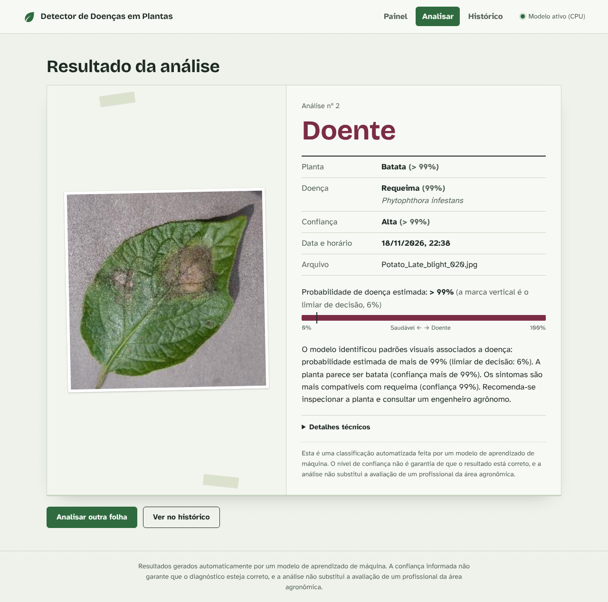

# Detector de Doenças em Plantas

Sistema que analisa a fotografia de uma folha com uma rede neural convolucional e informa se ela parece **saudável** ou **doente**. Quando tem confiança suficiente, informa também a **planta** e a **doença**. O sistema mostra a probabilidade estimada e uma mensagem explicativa, e guarda um histórico das análises.

> **Aviso:** o resultado é uma classificação automatizada. O nível de confiança não garante que o diagnóstico esteja correto, e a análise **não substitui a avaliação de um profissional da área agronômica**.



## Resultados medidos (conjunto de teste, 177 fotos nunca usadas no treino)

| O que foi medido | Resultado |
|---|---|
| Acerto saudável × doente (limiar calibrado de 6%) | **97,7%** (173/177) |
| Sensibilidade: folhas doentes detectadas | 99,0% (95/96) |
| Especificidade: folhas saudáveis reconhecidas | 96,3% (78/81) |
| Mesmo modelo com o limiar padrão de 50% | 96,0% (sensibilidade 92,7%) |
| Planta correta (modelo auxiliar), quando exibida | 96,6% (exibida em 99% das fotos) |
| Doença correta (modelo auxiliar), quando exibida | 88,8% (exibida em 94% das folhas doentes) |
| Fotos que não são folhas marcadas como "inconclusivo" | 15 de 15 no teste automatizado |
| Folhas reais marcadas, por engano, como "inconclusivo" | 2 de 177 (1,1%) |

Todas as fotos vêm do mesmo banco de imagens (folhas isoladas sobre fundo neutro). **Em fotos tiradas no campo, o desempenho tende a ser menor.** Os detalhes estão em [`docs/RELATORIO_TECNICO.md`](docs/RELATORIO_TECNICO.md).

## Tecnologias

| Camada | Tecnologia |
|---|---|
| Inteligência artificial | Python 3.10+, PyTorch, torchvision (MobileNetV3-Small com *transfer learning*) |
| Avaliação | scikit-learn, matplotlib, NumPy |
| API | FastAPI, Uvicorn, Pillow |
| Banco de dados | SQLite (já incluso no Python) |
| Interface | React 18 + Vite (já compilada em `frontend/dist`) |
| Testes | pytest, httpx, scikit-image, Playwright (opcional, teste no navegador) |

## Estrutura de pastas

```
detector_plantas/
├── api.py                 API REST + serve a interface web
├── inferencia.py          serviço de análise (validação, modelo, explicação)  [novo]
├── banco.py               histórico em SQLite                                  [novo]
├── rotulos.py             nomes em português das plantas e doenças             [novo]
├── config.py              caminhos, hiperparâmetros, CPU/GPU
├── dataset.py             carregamento das imagens e data augmentation
├── modelo.py              arquiteturas (MobileNet, ResNet18, CNN) e carregamento
├── train.py               treino do modelo principal (doente x saudável)
├── train_detalhado.py     treino do modelo auxiliar (planta + doença, 33 classes) [novo]
├── calibrar.py            limiares calculados com treino/validação               [novo]
├── evaluate.py            avaliação no conjunto de teste
├── predict.py             classificação pelo terminal
├── run_pipeline.py        cria venv, instala, treina se necessário e sobe a API
├── iniciar_windows.bat    atalho de inicialização no Windows                     [novo]
├── testar_windows.bat     executa os testes no Windows                           [novo]
├── requirements.txt       bibliotecas necessárias
├── requirements-dev.txt   bibliotecas para os testes                             [novo]
├── data/                  train/ val/ test/, cada um com doente/ e saudavel/
├── modelos/
│   ├── melhor_modelo.pth      modelo principal ORIGINAL (preservado, sem alterações)
│   ├── modelo_detalhado.pth   modelo auxiliar planta + doença               [novo]
│   ├── calibracao.pt          limiares e referência de padrão                [novo]
│   ├── treino_info.json       "impressão digital" do último treino
│   └── backup/                cópias de segurança (inclui o modelo original entregue)
├── resultados/            relatórios, matriz de confusão, métricas
├── frontend/              código React (src/) e versão compilada (dist/)
├── tests/                 44 testes automatizados
├── docs/                  relatório técnico, roteiro de apresentação, capturas de tela
└── instancia/             criada ao usar: historico.db, uploads/, logs/
```

## Instalação e execução no Windows 10 e 11

### Pré-requisitos

1. **Python 3.10 ou mais recente** (recomendado: 3.12 ou 3.13). Baixe em <https://www.python.org/downloads/> e, na instalação, marque **"Add python.exe to PATH"**.
2. Confira no **Prompt de Comando** (`Win + R` → `cmd`):
   ```bat
   python --version
   ```
3. **Node.js** só é necessário se você quiser **alterar** a interface. A versão compilada já vem em `frontend/dist`.

### Forma mais simples: dois cliques

Extraia o ZIP, abra a pasta `detector_plantas` e dê dois cliques em **`iniciar_windows.bat`**.

- Na **primeira vez**, o script cria o ambiente virtual `venv\` e instala as bibliotecas. O PyTorch é grande, então isso leva de 5 a 15 minutos, conforme a internet.
- O script **não retreina** o modelo, porque detecta que os dados e o código de treino não mudaram, e sobe a API.
- Quando aparecer `API pronta`, abra **<http://localhost:8000>** no navegador.

Para parar, pressione `Ctrl + C` na janela preta.

### Passo a passo manual (Prompt de Comando)

```bat
cd C:\caminho\para\detector_plantas

:: 1. Criar e ativar o ambiente virtual
python -m venv venv
venv\Scripts\activate

:: 2. Instalar as dependências
python -m pip install --upgrade pip
pip install -r requirements.txt

:: 3. Executar o backend (API + interface web)
python api.py
```

Abra <http://localhost:8000> para a interface e <http://localhost:8000/docs> para a documentação interativa da API.

> **PowerShell:** se `venv\Scripts\activate` for bloqueado, rode uma vez `Set-ExecutionPolicy -Scope CurrentUser RemoteSigned` ou use `venv\Scripts\activate.bat` pelo `cmd`.

> **GPU NVIDIA (opcional):** o `pip install torch` padrão no Windows usa a CPU, o que basta para este projeto (cada análise leva cerca de 30 ms). Para usar CUDA, instale o PyTorch pelo comando indicado em <https://pytorch.org/get-started/locally/> **antes** do `requirements.txt`. O sistema escolhe a GPU automaticamente quando ela está disponível (`config.dispositivo()`).

### Executar o frontend em modo de desenvolvimento (opcional)

Só é necessário para alterar a interface. Requer Node.js 18 ou mais recente (<https://nodejs.org>).

```bat
:: em um segundo terminal, com a API rodando no primeiro
cd frontend
npm install
npm run dev
```

Abra <http://localhost:5173>. As chamadas `/api` são encaminhadas para a porta 8000. Para publicar as alterações na porta 8000:

```bat
npm run build
```

## Como usar

1. **Painel:** mostra quantas análises foram feitas, quantas folhas saíram saudáveis, doentes e inconclusivas, o desempenho medido do modelo e as últimas análises.
2. **Analisar:** clique em **Selecionar imagem** (ou arraste a foto), confira a pré-visualização e clique em **Analisar folha**.
3. **Resultado:** veja a classificação, a planta e a doença (quando identificadas com segurança), o nível de confiança, a régua de probabilidade com o limiar de decisão, a data e o horário. Em **Detalhes técnicos** estão as três hipóteses mais prováveis do modelo auxiliar.
4. **Histórico:** lista todas as análises, com filtro por resultado. Clique em uma análise para vê-la novamente ou excluí-la. O histórico fica em `instancia\historico.db` e continua lá depois de reiniciar.

Para testar, use as fotos de `data\test\` (o modelo nunca as viu no treino). Fotos de uma única folha sobre fundo liso dão os resultados mais confiáveis. Fotos que não são de folhas recebem **"Inconclusivo"**.

### Pelo terminal

```bat
python predict.py data\test\doente\Potato_Late_blight_020.jpg
python predict.py data\test\saudavel
python predict.py minha_foto.jpg --json
```

### Pela API

| Método | Rota | Função |
|---|---|---|
| GET | `/api/saude` | estado da API, do modelo e do banco |
| GET | `/api/modelo` | arquitetura, classes, limiares e métricas |
| POST | `/api/analisar` | envia a foto (campo `imagem`, multipart) e recebe o resultado em JSON |
| GET | `/api/historico?limite=20&deslocamento=0&classificacao=doente` | lista paginada |
| GET / DELETE | `/api/historico/{id}` | consulta ou exclui uma análise |
| GET | `/api/estatisticas` | totais do painel |
| GET | `/api/imagens/{arquivo}` | imagem analisada |
| GET, POST | `/status`, `/analisar` | rotas da versão anterior (mantidas por compatibilidade) |

```bat
curl -F "imagem=@data\test\doente\Potato_Late_blight_020.jpg" http://localhost:8000/api/analisar
```

Os erros sempre voltam como `{"erro": "mensagem"}`: 400 (arquivo vazio), 413 (acima de 10 MB), 415 (não é imagem ou formato não suportado), 422 (imagem corrompida, menor que 64×64 px ou de uma cor só), 404, 500 (falha do modelo) e 503 (modelo não carregado).

## Treinamento

Com a `venv` ativada:

```bat
:: modelo principal (doente x saudável), o mesmo processo original
python train.py --arquitetura mobilenet --epocas 10
python evaluate.py

:: modelo auxiliar (planta + doença), partindo do modelo principal
python train_detalhado.py --epocas 15

:: limiares e verificação de padrão (sempre depois de treinar)
python calibrar.py
```

Ou tudo de uma vez, só quando algo mudou: `python run_pipeline.py` (para forçar: `--retreinar`).

**O modelo anterior nunca é apagado.** Antes de sobrescrever, `train.py`, `train_detalhado.py` e `run_pipeline.py` copiam o modelo atual para `modelos\backup\`. O modelo original entregue com o projeto está em `modelos\backup\original_entregue\`. Para restaurar um modelo, copie o `.pth` de volta para `modelos\` e rode `python calibrar.py`.

Depois de retreinar o modelo principal, rode também `train_detalhado.py` e `calibrar.py`. A API detecta (pelo hash SHA-256) quando a calibração não corresponde ao modelo e volta ao limiar de 50%, mostrando um aviso no log.

## Testes

```bat
venv\Scripts\activate
pip install -r requirements-dev.txt
python -m pytest -v
```

Ou dê dois cliques em `testar_windows.bat`. Para incluir o teste no navegador real: `python -m playwright install chromium`. Sem ele, esse teste é ignorado automaticamente.

| Arquivo | O que verifica |
|---|---|
| `test_modelo.py` | carregamento do `.pth`, arquitetura idêntica à do treino, classes, pré-processamento e normalização, modo de avaliação, CPU/GPU, acurácia no teste completo, folhas saudáveis e doentes, planta e doença |
| `test_padrao.py` | fotos que não são folhas → inconclusivo; poucas folhas reais rejeitadas |
| `test_validacao.py` | arquivo vazio, texto, maior que 10 MB, JPEG truncado, imagem pequena, de uma cor só, GIF, os 4 formatos aceitos, transparência, rotação EXIF |
| `test_api.py` | todos os endpoints, erros em JSON, falha do modelo, histórico, filtro, paginação, exclusão, segurança das imagens, **persistência após reiniciar**, rotas antigas |
| `test_pipeline.py` | dados idênticos aos do treino original, não retreina sem mudanças, backup do modelo |
| `test_e2e_navegador.py` | navegador → interface React → API → modelo → SQLite |

A última execução (**43 aprovados, 1 ignorado**: o teste de GPU, por falta de placa NVIDIA na máquina de teste) está em [`docs/resultados_testes.txt`](docs/resultados_testes.txt).

## Documentação para a apresentação

- [`docs/RELATORIO_TECNICO.md`](docs/RELATORIO_TECNICO.md): problemas encontrados, correções, arquitetura, modelo, dataset e métricas.
- [`docs/APRESENTACAO.md`](docs/APRESENTACAO.md): roteiro para o professor e sugestões de demonstração.

## Solução de problemas

| Sintoma | Solução |
|---|---|
| `'python' não é reconhecido` | Reinstale o Python marcando "Add to PATH" ou use `py` no lugar de `python` |
| A página mostra "API indisponível" | A janela da API precisa estar aberta; confira a mensagem de erro nela |
| `Address already in use` / porta 8000 ocupada | Feche a outra janela da API ou rode `uvicorn api:app --port 8001` |
| Muitos resultados "Inconclusivo" com fotos próprias | Fotografe uma única folha, centralizada, sobre fundo liso (papel ou mesa clara) |
| Log da API | `instancia\logs\api.log` |
| Apagar o histórico | Feche a API e apague a pasta `instancia\` |
